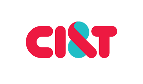

[🇧🇷 Português](https://github.com/jhonatasal/jhonatasal/blob/main/README.md) · [🇪🇸 Español](https://github.com/jhonatasal/jhonatasal/blob/main/README.es.md) · **🇺🇸 English**

# Hey, I'm Jhonatas 👋

**Software Engineer at Mercado Livre** · Backend, platform engineering, and distributed systems

[Connect on LinkedIn](https://www.linkedin.com/in/jhonatas-alves-79012115b/)

I started out in support, troubleshooting issues with SQL and Linux. These days I write **Java and Go**, and I enjoy building tools that take repetitive work off other developers' plates.

### 🎙️ What I'm working on now

At **Mercado Livre**, I build services for a platform that connects phone calls to AI agents. I work on session management, audio generation, and real-time integrations over WebSockets. I'm also exploring WebRTC to improve how the platform handles voice.

### 🛠️ Where I've worked

  
  &nbsp;
  
  &nbsp;
  
  &nbsp;
  

- **CI&T** · I was the tech lead on the platform team for Porto Seguro's insurance broker portal. I built internal tools and standardized workflows for product teams. Before that, I developed reusable libraries and automations for banking teams.
- **Zallpy** · I built features for Unicred's loyalty program and integrated Quarkus and AWS services with legacy systems.
- **RJ Consultores** · I worked on Java microservices and integrations for the road transport industry.

I've also worked with **Spring Boot, Quarkus, PostgreSQL, Redis, and AWS messaging**. I use Grafana, Dynatrace, and CloudWatch to see how services behave in production.

### 🛒 A side project I shipped

I built **Barato Plus** to answer a grocery-shopping question: *where can I get this product for less?* The app compares prices, logs purchases by scanning Brazilian electronic receipts (NFC-e), and helps you plan your next shopping trip.

**Flutter** for the app · **Spring Boot, PostgreSQL, and Redis** for the backend

[Find Barato Plus on Google Play ↗](https://play.google.com/store/apps/details?id=br.com.baratoplus)
