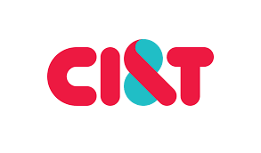

[🇧🇷 Português](https://github.com/jhonatasal/jhonatasal/blob/main/README.md) · **🇪🇸 Español** · [🇺🇸 English](https://github.com/jhonatasal/jhonatasal/blob/main/README.en.md)

# ¡Hola, soy Jhonatas! 👋

**Software Engineer en Mercado Livre** · Backend, plataformas y sistemas distribuidos

[Conectemos en LinkedIn](https://www.linkedin.com/in/jhonatas-alves-79012115b/)

Empecé en soporte, investigando problemas con SQL y Linux. Hoy programo en **Java y Go** y disfruto creando herramientas que les ahorran tareas repetitivas a otros desarrolladores.

### 🎙️ En qué estoy trabajando ahora

En **Mercado Livre**, desarrollo servicios para una plataforma que conecta llamadas telefónicas con agentes de IA. Trabajo con gestión de sesiones, generación de audio e integraciones en tiempo real mediante WebSockets. También estoy explorando WebRTC para mejorar los flujos de voz.

### 🛠️ Por dónde he pasado

  
  &nbsp;
  
  &nbsp;
  
  &nbsp;
  

- **CI&T** · Fui líder técnico del equipo de plataforma del Portal del Corredor de Porto Seguro. Creé herramientas internas y estandaricé procesos para los equipos de producto. Antes desarrollé bibliotecas y automatizaciones para equipos del sector bancario.
- **Zallpy** · Desarrollé funciones para el programa de fidelización de Unicred e integré servicios de Quarkus y AWS con sistemas heredados.
- **RJ Consultores** · Trabajé con microservicios en Java e integraciones para el sector del transporte por carretera.

También he trabajado con **Spring Boot, Quarkus, PostgreSQL, Redis y mensajería en AWS**. Para observar los servicios en producción, uso Grafana, Dynatrace y CloudWatch.

### 🛒 Un proyecto que se hizo realidad

Creé **Barato Plus** para responder una pregunta al hacer la compra: *¿dónde está más barato este producto?* La app compara precios, registra compras escaneando el comprobante fiscal brasileño (NFC-e) y ayuda a organizar la lista de la próxima compra.

**Flutter** en la app · **Spring Boot, PostgreSQL y Redis** en el backend

[Ver Barato Plus en Google Play ↗](https://play.google.com/store/apps/details?id=br.com.baratoplus)
