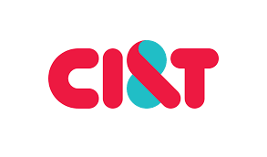

[🇧🇷 PT-BR](#pt-br) · [🇪🇸 Español](#es) · [🇺🇸 English](#en)

# Opa, eu sou o Jhonatas 👋

**Software Engineer no Mercado Livre** · Backend, plataforma e sistemas distribuídos

Comecei no suporte, investigando problemas com SQL e Linux. Hoje, escrevo **Java e Go** e gosto de construir ferramentas que tiram trabalho repetitivo do caminho de outros devs.

### 🎙️ No que estou mexendo agora

No **Mercado Livre**, desenvolvo serviços para uma plataforma que conecta chamadas telefônicas a agentes de IA. Trabalho com sessões, geração de áudio e integrações em tempo real via WebSockets. Também venho explorando WebRTC para evoluir os fluxos de voz.

### 🛠️ Por onde passei

  
  &nbsp;
  
  &nbsp;
  
  &nbsp;
  

- **CI&T** · Fui líder técnico no time de plataforma do Portal do Corretor da Porto Seguro. Criei ferramentas internas e padronizei processos para os times de produto. Antes disso, desenvolvi bibliotecas e automações para equipes do setor bancário.
- **Zallpy** · Desenvolvi funcionalidades para o programa de fidelidade da Unicred e integrei serviços em Quarkus e AWS a sistemas legados.
- **RJ Consultores** · Trabalhei com microsserviços Java e integrações no setor rodoviário.

Além de Java e Go, já trabalhei com **Spring Boot, Quarkus, PostgreSQL, Redis e mensageria na AWS**. Para acompanhar o que acontece em produção, uso ferramentas como Grafana, Dynatrace e CloudWatch.

### 🛒 Um projeto que saiu do papel

Criei o **Barato Plus** para resolver uma dúvida de mercado: *onde esse produto está mais barato?* O app compara preços, lê a NFC-e para registrar compras e ajuda a organizar a lista da próxima ida ao mercado.

**Flutter** no app · **Spring Boot, PostgreSQL e Redis** no backend

[Ver o Barato Plus na Google Play ↗](https://play.google.com/store/apps/details?id=br.com.baratoplus)

---

[🇧🇷 PT-BR](#pt-br) · [🇪🇸 Español](#es) · [🇺🇸 English](#en)

# ¡Hola, soy Jhonatas! 👋

**Software Engineer en Mercado Livre** · Backend, plataformas y sistemas distribuidos

[Conectemos en LinkedIn](https://www.linkedin.com/in/jhonatas-alves-79012115b/)

Empecé en soporte, investigando problemas con SQL y Linux. Hoy programo en **Java y Go** y disfruto creando herramientas que les ahorran tareas repetitivas a otros desarrolladores.

### 🎙️ En qué estoy trabajando ahora

En **Mercado Livre**, desarrollo servicios para una plataforma que conecta llamadas telefónicas con agentes de IA. Trabajo con gestión de sesiones, generación de audio e integraciones en tiempo real mediante WebSockets. También estoy explorando WebRTC para mejorar los flujos de voz.

### 🛠️ Por dónde he pasado

  
  &nbsp;
  
  &nbsp;
  
  &nbsp;
  

- **CI&T** · Fui líder técnico del equipo de plataforma del Portal del Corredor de Porto Seguro. Creé herramientas internas y estandaricé procesos para los equipos de producto. Antes desarrollé bibliotecas y automatizaciones para equipos del sector bancario.
- **Zallpy** · Desarrollé funciones para el programa de fidelización de Unicred e integré servicios de Quarkus y AWS con sistemas heredados.
- **RJ Consultores** · Trabajé con microservicios en Java e integraciones para el sector del transporte por carretera.

También he trabajado con **Spring Boot, Quarkus, PostgreSQL, Redis y mensajería en AWS**. Para observar los servicios en producción, uso Grafana, Dynatrace y CloudWatch.

### 🛒 Un proyecto que se hizo realidad

Creé **Barato Plus** para responder una pregunta al hacer la compra: *¿dónde está más barato este producto?* La app compara precios, registra compras escaneando el comprobante fiscal brasileño (NFC-e) y ayuda a organizar la lista de la próxima compra.

**Flutter** en la app · **Spring Boot, PostgreSQL y Redis** en el backend

[Ver Barato Plus en Google Play ↗](https://play.google.com/store/apps/details?id=br.com.baratoplus)

---

[🇧🇷 PT-BR](#pt-br) · [🇪🇸 Español](#es) · [🇺🇸 English](#en)

# Hey, I'm Jhonatas 👋

**Software Engineer at Mercado Livre** · Backend, platform engineering, and distributed systems

[Connect on LinkedIn](https://www.linkedin.com/in/jhonatas-alves-79012115b/)

I started out in support, troubleshooting issues with SQL and Linux. These days I write **Java and Go**, and I enjoy building tools that take repetitive work off other developers' plates.

### 🎙️ What I'm working on now

At **Mercado Livre**, I build services for a platform that connects phone calls to AI agents. I work on session management, audio generation, and real-time integrations over WebSockets. I'm also exploring WebRTC to improve how the platform handles voice.

### 🛠️ Where I've worked

  
  &nbsp;
  
  &nbsp;
  
  &nbsp;
  

- **CI&T** · I was the tech lead on the platform team for Porto Seguro's insurance broker portal. I built internal tools and standardized workflows for product teams. Before that, I developed reusable libraries and automations for banking teams.
- **Zallpy** · I built features for Unicred's loyalty program and integrated Quarkus and AWS services with legacy systems.
- **RJ Consultores** · I worked on Java microservices and integrations for the road transport industry.

I've also worked with **Spring Boot, Quarkus, PostgreSQL, Redis, and AWS messaging**. I use Grafana, Dynatrace, and CloudWatch to see how services behave in production.

### 🛒 A side project I shipped

I built **Barato Plus** to answer a grocery-shopping question: *where can I get this product for less?* The app compares prices, logs purchases by scanning Brazilian electronic receipts (NFC-e), and helps you plan your next shopping trip.

**Flutter** for the app · **Spring Boot, PostgreSQL, and Redis** for the backend

[Find Barato Plus on Google Play ↗](https://play.google.com/store/apps/details?id=br.com.baratoplus)
